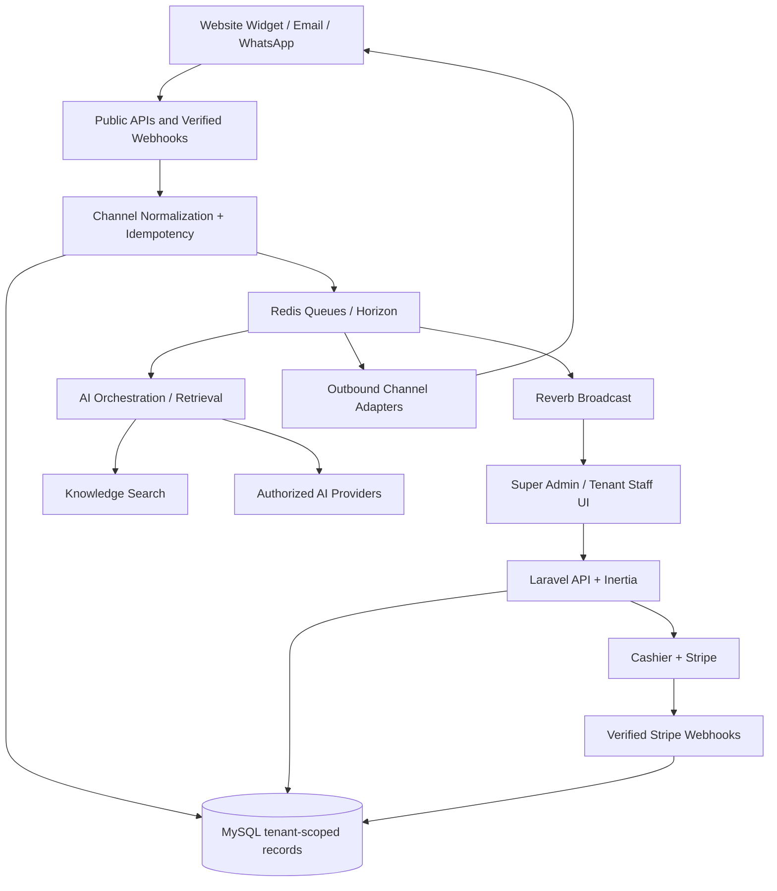

# SupportFlow AI — Advanced Laravel Multi-Tenant AI Customer Support SaaS

**Document type:** Implementation architecture and phased delivery plan  
**Status:** Planning only — no code implementation  
**Date:** October 28, 2026  
**Audience:** Product owner, Laravel architects, engineering team, QA, security, operations  
**Target stack:** Laravel 13 / PHP 8.3+, Vue 3, Inertia.js, Tailwind CSS, MySQL 8.4, Redis, Laravel AI SDK, Reverb, Horizon, Cashier/Stripe

> This is a design proposal, not an assessment of an existing codebase. Package versions, external API policies, data residency obligations, costs, and Stripe account availability must be confirmed before implementation.

---

## 1. Product vision and boundaries

### 1.1 Product vision
Create a multi-tenant customer-support platform that consolidates website chat, email, and WhatsApp (subject to channel approvals) into a unified inbox. Each company has its own workspace, agents, customers, conversations, knowledge base, AI assistants, reports, integrations, and subscription. The AI assistant must answer from authorized tenant content, explain when it is uncertain, and transfer complex conversations to staff.

### 1.2 Target customers
- Small and medium businesses needing a shared support inbox.
- E-commerce, SaaS, education, service and B2B support organizations.
- Growing support teams needing AI deflection, SLAs and automation.
- Enterprise customers needing advanced permissions, audit trails, retention, SSO and optional dedicated infrastructure.

### 1.3 Goals
1. Reliable inbound/outbound messages, without duplicates or lost replies.
2. Strict cross-tenant data isolation.
3. AI assistance that is measurable, controllable and safe to deploy.
4. Fast agent collaboration and clear human takeover.
5. Predictable cost controls, feature entitlements and verified Stripe subscriptions.
6. Production readiness: testing, logs, metrics, backups, security and recovery procedures.

### 1.4 Explicit exclusions from initial release
- Autonomous refunds or financial actions without explicit approval.
- Unrestricted browsing or arbitrary AI tool execution.
- Full contact-center voice/telephony, native mobile apps, social DM integrations and complex marketing campaigns.
- All enterprise compliance certifications as claims; those need independent assessment.
- Microservice architecture on day one.

### 1.5 Definition of MVP
Tenant onboarding; owner/admin/agent roles; website chat widget; real-time shared inbox; contacts; assignment and notes; ticket states; a basic knowledge base; AI-suggested agent replies; human handoff; notifications; usage metering; Stripe subscriptions; dashboard; audits and retention controls. Email and WhatsApp are introduced in later phases rather than blocking the reliable first release.

---

## 2. Architecture decisions

| Concern | Initial recommendation | Evolution path |
|---|---|---|
| Application | Laravel modular monolith organized by domain | Extract channel delivery/AI workers only when justified |
| Frontend | Vue 3 + Inertia.js + Tailwind | Public widget as separate lightweight JS bundle |
| Primary data | MySQL 8.4 with `tenant_id` | Large enterprise tenants may get database-per-tenant |
| Cache, locking, jobs | Redis + Horizon | Dedicated worker pools; SQS when scale requires |
| Real time | Reverb + private Echo channels | Separate scaled Reverb nodes |
| AI | Laravel AI SDK as provider facade | AI gateway, provider routing and evaluations |
| RAG | MySQL FULLTEXT + vetted passages initially | Dedicated vector search with tenant namespace/filter |
| File storage | Private S3-compatible buckets | Region-specific storage if required |
| Billing | Organization as Stripe/Cashier billable entity | Enterprise contracts, metered Stripe usage |
| Auth | Laravel session auth for staff; Sanctum for API | SAML/OIDC SSO later |
| Authorization | Policies + Spatie tenant-scoped teams | Object-level and custom role permissions |
| Integration | Channel adapter interface and webhook inbox | Connector marketplace and integration SDK |

**Tenancy invariant:** `tenant_id` is established from a trusted host/session/authenticated membership or signed channel mapping, never from a client-supplied body alone. Every tenant-owned query, route binding, broadcast, queued job, search result, object-storage key, audit event, export and webhook mapping must enforce it. A platform Super Admin is not automatically permitted to read customer messages; audited break-glass access is a separate permission and workflow.

**Modular monolith domains:** Identity & Organizations; Tenant Management; Contacts; Channels; Inbox; Tickets; AI & Knowledge; Automation; SLA; Notifications; Analytics; Billing & Metering; Audit & Compliance; Platform Operations.

---

## 3. Logical architecture and principal flows



### 3.1 Incoming message lifecycle
1. Receive website widget event or a channel provider webhook.
2. Verify signature/token, origin as applicable, timestamp tolerance and channel ownership.
3. Resolve channel account to trusted `tenant_id`; reject unknown/disabled channels.
4. Store inbound delivery in an idempotent webhook inbox keyed by provider event/message ID.
5. Normalize sender, conversation, attachments, timestamps and message content.
6. Commit customer/message/event and an outbox notification atomically.
7. Queue classification, ticket assignment, SLA updates and optional AI generation after commit.
8. Realtime broadcast to authorized private tenant/conversation channels.
9. Decide: human-only; AI draft; or AI auto-reply if policy, confidence and channel limits permit.
10. Deliver outbound message using an idempotent delivery record, store provider result, retry safely and update state.

### 3.2 AI answer flow
Incoming message → check consent/policy/budget → classify intent and risk → retrieve tenant-approved knowledge → compose grounded answer with references → safety/PII checks → either save draft for staff approval or send automatically if allowed → store token usage, retrieval evidence, policy decisions and outcome → transfer to human on low confidence or explicit request.

### 3.3 Human handoff flow
AI detects trigger or user requests a person → mark `handoff_requested` → disable automated outbound messages for the conversation → queue assignment by team, capacity and business hours → notify agent → acknowledge takeover → resume only if staff authorizes it or a new conversation is created.

### 3.4 Outbound message reliability
Keep separate `messages` and `message_deliveries` with states such as queued, sending, sent, delivered, failed. A unique delivery idempotency key prevents duplicate sends on worker retries where supported; for ambiguous timeouts reconcile with provider before resending where APIs allow. Use transactional outbox to avoid message-save/schedule mismatches.

---

## 4. User roles and permissions

### 4.1 Platform-level roles
- **Platform Super Admin:** plans, feature catalog, approved AI models, tenant health, system configuration, platform incident response and billing oversight.
- **Platform Billing Admin:** plan catalog, organization subscriptions, refunds only through explicitly authorized workflows, invoice troubleshooting and revenue dashboards.
- **Platform Support Operator:** operational metadata, support escalations and system diagnostics; never unrestricted tenant conversation access by default.

### 4.2 Tenant roles
- **Tenant Owner:** workspace ownership, team membership, payment methods, billing and destructive settings.
- **Tenant Admin:** channels, teams, policies, routing, knowledge, integrations and agent management.
- **Support Manager:** all authorized assigned teams' inboxes, tickets, SLA rules, QA reviews, reporting and workload balance.
- **Support Agent:** reply to permitted conversations, assign within allowed teams, create internal notes, use AI suggestions.
- **Knowledge Manager:** curate and publish knowledge, maintain document freshness and review AI coverage.
- **Billing Manager:** see invoices, seat count, usage and plan details without needing customer message access.
- **Analyst / Viewer:** read aggregated reporting with privacy-safe views; customer detail access only if explicitly granted.

### 4.3 Permission examples
`tenants.manage`, `members.invite`, `members.roles.assign`, `channels.configure`, `conversations.view_assigned`, `conversations.view_team`, `conversations.reply`, `conversations.export`, `tickets.assign`, `tickets.close`, `knowledge.publish`, `ai.agents.manage`, `ai.autoreply.enable`, `billing.manage`, `analytics.view`, `audit.view`, `tenant.data.delete`.

**Enforcement:** Laravel Policies/Gates plus scoped Spatie roles. If Spatie teams are used, set/refresh active team context correctly and test tenant switching. Use policy checks at the server, not UI-only hiding. Customer-facing widget sessions use distinct scoped credentials and cannot access staff API routes.

---

## 5. Product modules and feature specifications

### 5.1 Super Admin portal
- Overview: tenant count, trials, MRR/ARR estimates, AI usage cost, message volume, overdue invoices, webhook/queue failures.
- Tenant registry: workspace state, domain, billing owner, plan, trial, member counts, storage/message usage, compliance actions.
- Pricing catalog: plans, prices, limits, grandfathered pricing, trial policies, promotion eligibility, Stripe price mapping.
- Model catalog: available AI providers/models, regional support, cost budgets, allowed capabilities and default configurations.
- Feature flags: enable channel/AI capabilities by plan or rollout cohort.
- Operational center: queue health, failed jobs, delayed webhooks, channel outages, provider status, incidents and audit events.
- Access governance: platform administrators, break-glass access grants, MFA and immutable access audit.
- Support and compliance: tenant export requests, retention settings, lawful data deletion and service notices.

### 5.2 Tenant onboarding and workspace
- Owner signs up, verifies email, creates workspace and chooses public slug.
- Trial or plan selection, guided chat-widget install and initial team invitations.
- Business identity, timezone, locale, operating hours, branding, default department and sender identity.
- Multiple helpdesk teams/inboxes within one tenant; one user may belong to multiple tenants with distinct roles.
- Subscription is attached to tenant organization, not an individual staff account.

### 5.3 Shared omnichannel inbox
- Unified conversation list, assignee/team, unread state, tags, priority, channel, customer details and filters.
- Messages rendered as inbound/outbound system events; internal notes are never delivered externally.
- Search conversations and contacts; saved filters; canned responses; keyboard shortcuts.
- Assignment rules, reopen, snooze, merge subject to audit and careful lineage, transfer, escalation.
- Mentions, collaboration notes, read receipts and typing indicators only where supported.
- PII redaction for roles with limited access.

### 5.4 Website chat widget (MVP channel)
- Tenant-issued public widget identifier; origin allowlist and bot protection.
- Session-safe anonymous customer identity; optional verified identity mode via tenant-issued signed user token.
- Lightweight separate JS bundle; Vue widget with text-first interaction, attachments later.
- Welcome message, agent availability, offline mode, CSAT prompt, branding, locale and privacy notice.
- Rate limiting, spam protection, encryption in transit and secure private real-time messaging.

### 5.5 Email integration (post-MVP)
- Initial channel via provider-specific inbound email hooks and authorized sending provider.
- Verify inbound ownership, mail threading using message identifiers, bounce/complaint handling.
- Prevent autoreply loops, strip dangerous HTML, handle attachments as quarantined objects.
- Reply-to identities and domain verification; outbound DKIM/SPF/DMARC setup where applicable.

### 5.6 WhatsApp integration (post-MVP)
- Business authorization and approved provider account connection.
- Verified webhook ingestion, customer identity mapping, message status delivery events and media processing.
- Outbound template/category and customer-service-window restrictions implemented according to active Meta policy.
- Per-tenant phone number, opt-in records, template mapping and disconnection workflow.
- Compliance and provider approval required before offering as a general-availability channel.

### 5.7 Contacts and CRM-lite
- Per-tenant contacts, identifiers per channel, merged identity policy, organizations, custom fields and tags.
- Customer timeline, prior tickets, consent preferences, language, timezone and optional business metadata.
- Imported contacts must be deduplicated per tenant and not mixed across tenants.

### 5.8 Tickets and SLA
- Ticket number, title, customer, team, assignee, status (`open`, `pending`, `resolved`, `closed`), priority and category.
- Ticket events, collision-safe assignment, comments, attachments and linked conversations.
- Separate SLA policies for first response and resolution, per business calendar and holidays.
- Pause rules for customer-pending states, breach detection, escalation and immutable change history.

### 5.9 AI assistant studio
- Named AI assistants per tenant, default model, behavior instructions, tone, language, approved knowledge sources, safe-response template.
- Modes: **disabled**, **draft only**, **auto-reply within approved guardrails**.
- Prompt version history, testing playground, evaluation dataset, rollout and rollback.
- Retrieval citations, confidence/quality signals, policy-triggered handoff, model fallback.
- Restrict tool calls to approved read-only business APIs initially; write actions require explicit authorization and human approval.

### 5.10 Knowledge base and RAG
- Articles, categories, tags, status (`draft`, `review`, `published`, `archived`), locale and effective dates.
- Upload text/PDF documents with malware scanning, extraction, chunking and indexing; preserve document ownership and access rules.
- MVP: MySQL FULLTEXT article search plus keyword/entity matching; require source provenance in suggested answers.
- Advanced: tenant-isolated vector index and hybrid retrieval/reranking; avoid assuming generic MySQL supports Laravel's native vector schema features.
- Reindex asynchronously, remove unpublished/expired content from AI retrieval, support knowledge review and freshness reminders.

### 5.11 Automation and routing
- Event triggers: new message, ticket created, SLA approaching, no response, ticket closed, customer rating submitted.
- Conditions: inbox, language, customer tier, operating hours, message intent, priority, agent availability.
- Actions: assign, tag, set priority, notify, send approved template, request approval, create ticket.
- Rules have versioning, idempotency, dry-run testing, execution history and maximum action depth to avoid loops.

### 5.12 Reporting and quality
- Volume by channel, incoming vs resolved, first response time, resolution time, backlog, SLA compliance, agent productivity and CSAT.
- AI drafts accepted, edited and rejected; AI auto-reply rate; escalation rate, cost per resolved conversation, unsafe-response incidents.
- Clearly distinguish estimated AI deflection from verified resolution. Define metrics before launch.
- Tenant-filtered reports, timezone-aware aggregations, CSV export with access control and export audit.

### 5.13 Notifications and developer API
- In-app, email and optional messaging notifications with digest preferences and anti-spam throttles.
- Tenant API keys with narrow scopes, rotation, per-token quotas, audit history and revocation.
- Outbound signed webhooks, delivery retry and replay controls for customer integrations.

---

## 6. MySQL schema blueprint

Use UUID or ULID public identifiers where external exposure is possible; internal BIGINT IDs are also acceptable. Store all timestamps in UTC and render per tenant/customer timezone. Consider encryption for sensitive columns and private encrypted storage for files. Every tenant-owned relation must be checked for same-tenant ownership, including polymorphic relations.

### 6.1 Identity, tenants and membership
| Table | Key columns and purpose |
|---|---|
| `users` | id, name, email, password_hash, email_verified_at, mfa_state |
| `tenants` | id, public_id, name, slug, status, timezone, default_locale, owner_user_id |
| `tenant_domains` | id, tenant_id, hostname, verification_state |
| `tenant_user` | tenant_id, user_id, status, joined_at, invited_by |
| `tenant_invitations` | tenant_id, invited_email, token_hash, role_template, expires_at |
| `teams` | tenant_id, id, name, routing_priority |
| `team_user` | tenant_id, team_id, user_id, capacity_limit |
| Spatie role tables | role / permission bindings configured with tenant team scoping |
| `audit_logs` | tenant_id nullable for platform events, actor, action, subject, before/after redacted, request_id |

### 6.2 Contacts, channels and inbox
| Table | Key columns and purpose |
|---|---|
| `contacts` | id, tenant_id, display_name, email_normalized, phone_e164, locale |
| `contact_identities` | tenant_id, contact_id, channel_type, external_identity_hash |
| `contact_consents` | tenant_id, contact_id, purpose, status, collected_at, source |
| `inboxes` | id, tenant_id, name, channel_type, team_id, status |
| `channel_connections` | id, tenant_id, inbox_id, provider, external_account_id, encrypted_credentials_ref, status |
| `widget_configs` | tenant_id, inbox_id, public_key, allowed_origins, branding_json |
| `conversations` | id, tenant_id, inbox_id, contact_id, assignee_user_id, status, ai_mode, last_message_at |
| `conversation_members` | tenant_id, conversation_id, user_id, participant_role |
| `conversation_tags` | tenant_id, conversation_id, tag_id |
| `tags` | tenant_id, id, name, color |
| `messages` | id, tenant_id, conversation_id, direction, kind, author_type, author_id, body, provider_message_id, status |
| `message_attachments` | tenant_id, message_id, private_storage_key, mime, size, scan_status |
| `message_deliveries` | tenant_id, message_id, channel_connection_id, idempotency_key, provider_id, state, attempts |
| `inbound_webhook_events` | tenant_id nullable until resolution, provider, provider_event_id, signature_verified, processed_at, payload_ref |
| `outbox_events` | tenant_id, aggregate_type/id, event_type, payload, dispatched_at |

### 6.3 Tickets, automations and SLAs
| Table | Key columns and purpose |
|---|---|
| `tickets` | tenant_id, ticket_number, contact_id, conversation_id, team_id, assignee_user_id, priority, status |
| `ticket_events` | tenant_id, ticket_id, event_type, actor_id, payload, created_at |
| `business_calendars` | tenant_id, timezone, working_hours_json |
| `calendar_holidays` | tenant_id, calendar_id, local_date, reason |
| `sla_policies` | tenant_id, name, priority, first_response_minutes, resolution_minutes |
| `sla_instances` | tenant_id, ticket_id, due_at, paused_seconds, state, breached_at |
| `automation_rules` | tenant_id, trigger, conditions_json, actions_json, enabled, version |
| `automation_runs` | tenant_id, rule_id, event_id, state, steps, error_code |
| `canned_replies` | tenant_id, title, content, visibility, author_id |
| `satisfaction_surveys` | tenant_id, ticket_id, contact_id, score, comment |

### 6.4 AI and knowledge
| Table | Key columns and purpose |
|---|---|
| `ai_agents` | tenant_id, name, mode, model_id, active_version_id, status |
| `ai_agent_versions` | tenant_id, agent_id, instructions, config_json, created_by |
| `ai_model_catalog` | platform-level provider, model, capability, estimated_cost_policy, enabled |
| `knowledge_collections` | tenant_id, title, visibility, locale |
| `knowledge_articles` | tenant_id, collection_id, title, content, status, published_at, updated_by |
| `knowledge_sources` | tenant_id, collection_id, origin_type, object_key, indexing_status |
| `knowledge_chunks` | tenant_id, source_id, content, chunk_no, content_hash, publication_state |
| `ai_runs` | tenant_id, conversation_id, message_id, agent_version_id, mode, outcome, cost_estimate |
| `ai_retrieval_events` | tenant_id, ai_run_id, source_ids, scores, policy_version |
| `ai_feedback` | tenant_id, ai_run_id, agent_user_id, rating, edit_reason |
| `ai_usage_events` | tenant_id, ai_run_id, model, input_tokens, output_tokens, priced_amount_minor, unique_key |

### 6.5 Billing, analytics and compliance
| Table | Key columns and purpose |
|---|---|
| `plans` | id, code, name, billing_features_json, status |
| `plan_prices` | plan_id, currency, interval, stripe_price_id, amount_minor |
| `plan_entitlements` | plan_id, feature_code, limit_type, limit_value |
| `subscriptions` / `subscription_items` | Cashier-maintained Stripe subscription tables linked to tenant billable entity |
| `billing_webhook_events` | provider_event_id unique, event_type, received_at, processed_at, status |
| `usage_ledger` | tenant_id, period, metric, quantity, idempotency_key, source_type/id |
| `usage_aggregates` | tenant_id, period_start, metric, counted, reserved, updated_at |
| `payment_invoices` | tenant_id, stripe_invoice_id, state, amount_minor, currency, pdf_url_ref |
| `data_export_requests` | tenant_id, requestor_id, state, storage_key, expires_at |
| `deletion_requests` | tenant_id, subject/contact, status, retention_exception_reason |
| `analytics_daily` | tenant_id, metric_date, channel, counts, sums, version |

### 6.6 Keys, indexes and consistency
- Unique: `tenants.slug`; `tenant_domains.hostname`; `(tenant_id, tickets.ticket_number)`; `(tenant_id, inbox_id, external_identity)` as appropriate; `(provider, provider_event_id)`; `(tenant_id, idempotency_key)` for delivery and usage.
- Composite indexes: `(tenant_id, conversations.status, last_message_at)`; `(tenant_id, assignee_user_id, status)`; `(tenant_id, conversation_id, messages.created_at)`; `(tenant_id, tickets.status, priority, created_at)`; `(tenant_id, usage_period, metric)`.
- Foreign-key rules must prevent cross-tenant associations: query/authorization validation is required even where simple foreign keys exist; use composite constraints where feasible.
- Store money in integer minor units and record currency; no floating point for invoice reconciliation.
- Use row locks/optimistic versions for concurrent assignments, counters, ticket status changes and seat allocation.
- Preserve audit trails, but minimize sensitive content and avoid storing raw provider tokens in logs.

---

## 7. API surfaces and application structure (design only)

### 7.1 Route areas
- `/` — marketing homepage, pricing, docs.
- `/register`, `/login` — staff account lifecycle.
- `/app/{tenant}/dashboard` — workspace dashboard.
- `/app/{tenant}/inbox` — shared inbox.
- `/app/{tenant}/tickets` — ticket management.
- `/app/{tenant}/contacts` — contacts.
- `/app/{tenant}/ai` — AI agent policies and test playground.
- `/app/{tenant}/knowledge` — knowledge authoring.
- `/app/{tenant}/automations` — automation and SLA.
- `/app/{tenant}/analytics` — reports.
- `/app/{tenant}/settings` — members, channels and branding.
- `/app/{tenant}/billing` — pricing, invoices, plan changes.
- `/admin` — platform Super Admin.
- `/api/v1/widget/...` — customer chat widget APIs, isolated from staff APIs.
- `/webhooks/{provider}/...` — verified channel/provider events.
- `/stripe/webhook` — Cashier-verified billing events.

Route examples are proposed architecture labels, not implementation code. Tenant keys in paths must be resolved against authenticated memberships.

### 7.2 Proposed module boundaries
```
app/
  Domain/
    Identity/
    Tenancy/
    Channels/
    Inbox/
    Contacts/
    Tickets/
    Knowledge/
    AI/
    Automation/
    SLA/
    Billing/
    Analytics/
    Security/
  Http/
    Controllers/{Platform,Tenant,Widget,Webhook,Api}/
    Middleware/
    Requests/
    Resources/
  Jobs/{Channels,AI,Knowledge,Delivery,Reports,Billing}/
  Events/
  Listeners/
  Policies/
  Support/
resources/js/
  Pages/{Platform,Tenant,Auth,Marketing}/
  Components/{Inbox,ChatWidget,AI,Knowledge,Billing}/
routes/{web,api,channels,console}.php
```

**Code design conventions (for the future implementation):** thin controllers; form requests for validation; service/action classes for use cases; Eloquent models for persistence; provider adapters behind interfaces; events/outbox for integration; PHP enums for state; feature/policy checks server-side; data transfer objects at external service boundaries.

---

## 8. AI safety and support quality architecture

### 8.1 Operating modes
1. **Suggestion-only (MVP):** Generate proposed answers. Human agents approve/edit before sending.
2. **Guarded auto-response:** Only for safe intents (hours, policies, order status read-only with verified identity), using approved knowledge and thresholds.
3. **Assisted action (advanced):** External tools have allowlisted inputs, per-tenant permissions, dry-run controls, approval gates and auditable results.

### 8.2 Required safeguards
- Treat customer text and retrieved documents as untrusted data, not instructions.
- Never permit model-supplied `tenant_id`, arbitrary URLs/SQL, filesystem commands, or raw integration credentials.
- Enforce tenant filters **before retrieval** and **again before source inclusion**.
- Prompt-injection checks and provenance checks; no promise that filters are perfect.
- Hide credentials and redact sensitive PII from logs, traces and prompts when unnecessary.
- Explicit legal/privacy basis and disclosure for external AI processing; configure provider retention/data handling.
- Guard against hallucinated refunds, discounts, contractual commitments and unsupported policies.
- If knowledge is absent, respond with uncertainty and offer handoff rather than inventing an answer.
- Rate limits, token budgets, conversation context limits, per-tenant allowlists and provider timeouts.
- Record model, prompt version, retrieved sources, cost, decision and reason for fallback/handoff.

### 8.3 Evaluation methodology
- Seed a tenant-specific evaluation set of at least 100 representative support questions and expected policy outcomes before broad auto-replies.
- Measure groundedness, answer correctness, handoff precision, prohibited-answer rate, latency, cost, multilingual accuracy and customer satisfaction.
- Review false positives/negatives; release model/prompt changes through versioned feature flags and gradual rollout.
- Include malicious prompts, unrelated tenants' terms, missing knowledge, angry users, access-control checks and ambiguous orders.

---

## 9. Stripe billing, pricing, and entitlements

### 9.1 Billing model
**Tenant is billable.** Configure the Laravel Cashier `Billable` behavior on the tenant/organization model and customize/verify Cashier migrations/model mapping accordingly (do not assume default user-billing migration is sufficient).

### 9.2 Illustrative tier design (not real prices)
| Plan | Illustrative limits |
|---|---|
| Trial / Free | 1 inbox, 2 agents, 100 conversations/month, AI drafts only, small knowledge base |
| Starter | 3 inboxes, 5 agents, 2,000 conversations/month, AI drafts + limited AI credits |
| Growth | 10 inboxes, 20 agents, automations, SLA, analytics, controlled auto-replies |
| Enterprise | Custom seats, contracted quotas, SSO, advanced security, premium support, optional dedicated infrastructure |

All limits and prices are product decisions; confirm actual unit economics and Stripe-supported billing models before publishing.

### 9.3 Usage meters
- **Billable seats:** occupied agent seats (owners and managers count if licensing policy requires); define billable and nonbillable roles.
- **Conversations:** define exactly when a unique billed conversation is counted and whether reopenings count.
- **AI units:** model input/output tokens or normalized AI credits. Keep a provider cost ledger separate from customer-facing credits.
- **Messages:** optional channel-specific volume and pass-through provider charges if contracts permit.
- **Storage:** total tenant stored attachment bytes, measured periodically.

### 9.4 Subscription lifecycle
1. Tenant created, eligible for configured free/trial entitlements.
2. Owner chooses plan; backend validates price and creates Stripe Checkout session.
3. Redirect to Stripe. Return page shows `pending` until signed webhook confirms state.
4. Handle verified `checkout.session.completed`, `customer.subscription.*` and `invoice.*` events as relevant.
5. Deduplicate by Stripe event ID, tolerate out-of-order delivery, re-fetch current Stripe object when necessary and recalculate entitlements.
6. Persist subscription state; activate/adjust limits only after verified status.
7. For upgrades/downgrades, define effective dates, prorations and feature grace periods.
8. On payment failure, retry/dunning via Stripe; preserve access to historical data and apply a documented read-only/grace policy where appropriate.
9. On cancellation, disable premium actions at effective date; continue safe data export/retention, then execute contractual deletion lifecycle.
10. Give authorized billing managers access to invoices, payment method changes and billing portal.

**Important:** Never activate paid AI features merely because the customer opened the checkout success URL. Do not silently drop incoming customer messages during a billing failure; route to safe human/read-only fallback or explicitly report delivery state.

### 9.5 Metering consistency
- Reserve a budget/credit before expensive AI operations, reconcile actual usage afterward and release unused reservations.
- Each AI call and message charge has an immutable idempotency key.
- Local ledger is source of truth for entitlement enforcement; Stripe meter events are reconciled to the ledger.
- Define trial abuse prevention, soft vs hard limits, warnings at 80/95/100%, and concurrency caps.

---

## 10. Security, privacy and compliance planning

| Risk | Preventive controls |
|---|---|
| Cross-tenant data leakage | Tenant context middleware, scoped policies and relation validation, tenant-filtered caches/search, adversarial tests |
| Webhook spoofing/replay | Provider signatures, timestamp tolerance, event ID uniqueness, endpoint secrets and audit |
| Staff account takeover | MFA, device/session controls, login throttling, secure password reset, privileged action re-auth |
| Widget abuse/spam | Rate limiting, origin validation, challenge mechanism, IP reputation and abuse analytics |
| Stored XSS / rich message injection | Sanitization, content security policy, safe rendering, restrictive file types |
| Malicious uploads | Size/type limits, malware scanning, quarantine, presigned download URLs |
| SSRF through integrations | Strict egress allowlist, URL validation, metadata endpoint blocking, network policy |
| Prompt injection | Strict prompt/data separation, scoped retrieval, approved tools, independent authorization |
| AI privacy leakage | Minimized prompts, protected logs, provider agreements, consent/retention settings |
| Billing manipulation | Server-selected Stripe price, verified webhook, idempotency and ledger reconciliation |
| Insider access | Least privilege, break-glass approval, immutable audit, separated platform vs tenant roles |
| Sensitive export | Step-up auth, limited TTL, encrypted storage, audit and per-tenant entitlement |

**Privacy readiness:** Document lawful bases, privacy notices, data minimization, retention schedule, contact data access/deletion workflows, subprocessor register and regional residency. Consult counsel before asserting GDPR, Indian DPDP or other jurisdictional compliance. Enterprise certification (SOC 2/ISO 27001) is a later security program, not a package feature.

---

## 11. Reliability, operations and deployment

### 11.1 Worker pools
- `webhooks`: high priority, fast signature checks/persistence and acknowledgement.
- `inbox`: message normalization and ticket state changes.
- `realtime`: events and presence.
- `outbound`: external provider delivery and retry.
- `ai`: restricted concurrency, expensive inference operations, timeouts and budgets.
- `knowledge`: file scanning, parsing, embedding/reindexing.
- `analytics`: aggregates and exports.
- `billing`: Stripe reconciliation, ledger and alerts.

Enable after-commit dispatch or transactional outbox where necessary, so jobs never process uncommitted records. Use dead-letter/failure queues, dashboard alerts, bounded exponential backoff with jitter, provider circuit breakers and replay tooling.

### 11.2 Production topology
CDN/WAF → load balancer → stateless Laravel web instances; Reverb workers → Redis; separate Horizon workers by queue; managed MySQL with backups and replicas as needed; private object storage; encrypted secrets manager; observability stack. Isolate AI-provider and integration credentials from the browser.

### 11.3 Monitoring and recovery
- Uptime, 5xx, P95 API latency, WebSocket availability, worker queue age, failed-job rate, AI-provider errors and webhook delivery delay.
- Delivery success, duplicate prevention, mean handoff time, pending SLA breaches and AI cost per tenant.
- Daily automatic backups, restore drills, recovery-point and recovery-time objectives agreed before enterprise sales.
- Synthetic inbound widget journeys and Stripe test-mode renewal/dunning tests.
- Disaster recovery runbooks, emergency provider disable and feature flag rollback.

### 11.4 Testing strategy
- Unit: permissions, state machines, usage calculators, SLA clocks, rules.
- Feature: cross-tenant route/model binding, invitations, ticket assignment, search boundaries, invoice access.
- Integration: channel webhook signatures, message delivery retries, Stripe event duplication and reordering.
- AI evaluation: groundedness, wrong-tenant retrieval, prompt injection, handoff decisions, token accounting.
- E2E: visitor sends message → inbox updates → agent responds → visitor receives → ticket resolved → satisfaction request.
- Load: bursty inbound webhooks, thousands of concurrent chat sessions, slow AI providers and queue backpressure.
- Security: BOLA/IDOR, origin spoofing, XSS, CSRF, SSRF, signed webhooks, secrets exposure.

---

## 12. Phased delivery roadmap

Timelines below are **illustrative phase effort ranges**, not commitments or a final calendar. They assume an experienced cross-functional team, and some efforts overlap. For a solo developer, realistic elapsed time will be substantially greater.

### Phase 0 — Discovery and architecture sign-off (1–2 weeks)
**Deliverables:** product requirements, persona map, tenant design decision, initial channel selection, AI operating policy, data inventory, data retention, cost assumptions, support KPIs, architecture decision records.  
**Exit criteria:** sign-off on MVP boundaries, billing metric definitions, tenant boundaries, privacy risks, and product success criteria.

### Phase 1 — Foundation and quality platform (2–3 weeks)
**Deliverables:** Laravel project structure, Vue/Inertia shell, Tailwind design system, local Docker environment, MySQL/Redis, automated tests, CI, staging, secret management, logs, basic monitoring.  
**Exit criteria:** reproducible build, deploy and rollback; protected environment configuration; green CI smoke suite.

### Phase 2 — Auth, tenancy and RBAC (2–4 weeks)
**Deliverables:** signup/login, tenant creation, membership/invites, role policies, organization switcher, MFA plan, audit logging, cross-tenant test fixtures.  
**Exit criteria:** no tenant can view another tenant's records or broadcasts; role matrix tested server-side.

### Phase 3 — Super Admin and tenant setup (2–3 weeks)
**Deliverables:** platform dashboard, tenant registry, trial lifecycle, tenant profile, branding, teams, member management, flags and basic usage limits.  
**Exit criteria:** Super Admin can manage tenant status without acquiring unapproved message access; tenant owner can configure workspace.

### Phase 4 — Website widget and real-time inbox (4–6 weeks)
**Deliverables:** embeddable widget, anonymous session, channel mapping, messages, shared inbox, Reverb updates, assignment, internal notes, contact view, delivery lifecycle, rate limits.  
**Exit criteria:** end-to-end visitor/agent chat works with no duplicate message after retries, reconnects or refreshing.

### Phase 5 — Ticketing, teams and SLA (3–4 weeks)
**Deliverables:** ticket creation, categories/tags/priority, assignment routing, business hours, first-response/resolution SLAs, notifications and collaboration.  
**Exit criteria:** ticket states, SLA clocks (including holidays) and collision-safe assignment pass automated tests.

### Phase 6 — Knowledge base and basic AI assist (3–5 weeks)
**Deliverables:** draft/publish knowledge, MySQL search, AI agent settings, versioned prompts, cited suggested replies, AI usage ledger, manual approve/edit and handoff.  
**Exit criteria:** AI never sends automatically in MVP; citations are tenant-scoped; unknown answers produce handoff/draft refusal.

### Phase 7 — Controlled AI automation (3–5 weeks)
**Deliverables:** intent classification, low-risk auto-reply policies, confidence/fallback rules, per-tenant token budgets, evaluation suite, prompt rollout/rollback, risk thresholds.  
**Exit criteria:** measurable answer quality, non-autonomous handling of sensitive requests and budget enforcement under concurrency.

### Phase 8 — Stripe SaaS billing (2–4 weeks)
**Deliverables:** plan catalog, organization billable model, Checkout/portal, verified webhooks, usage meter, credit reservations, entitlement middleware, invoices and dunning policy.  
**Exit criteria:** successful verified subscription enables paid features; cancelled/failed/pending payment cannot grant unearned features; duplicate webhooks are safe.

### Phase 9 — Email and WhatsApp adapters (4–7 weeks)
**Deliverables:** email inbound/outbound identity, threading, failures and bounces; WhatsApp account onboarding subject to approval, templates, inbound statuses, compliant outbound rules, adapter testing.  
**Exit criteria:** verified channel end-to-end journeys, no cross-tenant routing, reliable retries and documented provider-specific restrictions.

### Phase 10 — Automations, analytics and QA (3–5 weeks)
**Deliverables:** rule engine, saved filters, CSAT, dashboards, AI acceptance/deflection analytics, exports, audit reports and quality review queues.  
**Exit criteria:** reporting definitions consistent with events and usage ledger; rule cycles and duplicate side effects prevented.

### Phase 11 — Hardening and beta (4–6 weeks)
**Deliverables:** penetration test remediation, load tests, a11y review, restore drills, error budgets, runbooks, onboarding flows, beta customer feedback and incident procedure.  
**Exit criteria:** service-level targets met, no critical open vulnerabilities, restore test passed, billing/customer-facing messaging audited.

### Phase 12 — Commercial launch (2–3 weeks)
**Deliverables:** public pricing, terms/privacy, account deletion/export, help documentation, operational rotation, production dashboards, launch checklist and safe feature rollout.  
**Exit criteria:** repeated onboarding and billing paths operate with supportable service reliability; product/engineering/security owners approve launch.

### Phase 13 — Enterprise expansion (separate roadmap)
**Candidates:** multi-language KB, hybrid vector search, CRM/e-commerce connectors, SSO, regional data residency, tenant-specific databases, advanced assignment optimizer, voice, API marketplace, enterprise SLA contracts, white label, AI action approval flows.  
**Exit criteria:** each enhancement has security/privacy review, tenant-scoped tests and measurable value justification.

### Recommended milestone sequence
- **M1 Foundational:** Phases 0–3.
- **M2 Usable support product:** Phases 4–5.
- **M3 AI-assisted support MVP:** Phase 6 plus Phase 8 billing before paid rollout.
- **M4 Guarded AI and channels:** Phases 7 and 9.
- **M5 Production launch:** Phases 10–12.
- **M6 Enterprise:** Phase 13 by customer demand.

---

## 13. Team, risks and estimated effort

**Suggested team:** technical lead/Laravel architect, 2–3 Laravel developers, 1–2 Vue developers, QA automation engineer, part-time DevOps/security engineer, and product designer/owner. A small team can combine roles, at the cost of longer delivery time.

**Primary risks:** Meta/WhatsApp approval or policy changes, unpredictable AI costs, RAG content quality, duplicate webhooks, real-time scaling, retention/data protection, poor initial support workflows, subscription edge cases and provider outages.

**Risk controls:** implement web chat first, introduce AI in draft mode, constrain tenant budgets, establish idempotency from day one, continuously run tenant isolation tests, keep a manual human-first fallback, and validate billing workflows in Stripe test mode before collecting charges.

---

## 14. Acceptance criteria and release gates

### Required MVP product acceptance
- Tenant signup and invitation flow with distinct roles.
- Tenant A cannot access Tenant B via URL guessing, IDs, exports, broadcasts, cache or searches.
- Public widget operates only for its configured tenant and origin policy.
- Incoming message shown once even on webhook replay.
- Agent can assign, reply, close, reopen and add internal notes with correct ACLs.
- Knowledge articles only affect their own tenant's AI draft suggestions.
- AI suggestions clearly label generated material and surface source references.
- Customer can request a human; autonomous messaging pauses immediately.
- Metering and plan limits remain correct under retries and concurrency.
- Stripe Checkout success URL alone cannot activate a plan; verified event required.
- Test-mode payment failure, past-due, cancellation, upgrades and invoice cases covered.
- Logs/alerts and backup/restore procedures validated.

### Nonfunctional targets (proposed, not promises)
- 99.9% monthly availability target after operational maturity.
- Chat inbound acknowledged quickly; messages persisted durably before expensive AI work.
- P95 core dashboard/inbox reads under a documented target in realistic load tests.
- Worker queue-age SLO and AI-provider timeout/hand-off SLO defined with real-world measurements.
- Provider outages degrade gracefully to human queueing and visible delivery state.

---

## 15. First 30 days of planning and validation

**Week 1:** research tenant personas, define MVP channel and ticket workflow; approve tenancy and primary billing unit; identify PII/subprocessors.  
**Week 2:** write user stories, permissions matrix, data model, API contract and delivery semantics; choose widget approach and test environments.  
**Week 3:** map AI knowledge article lifecycle and evaluation set; document human handoff, refund/action restrictions and usage ledger.  
**Week 4:** establish delivery milestones, acceptance tests, observability thresholds, cost budgets and architecture review; prepare engineering tickets **without implementing features until approval**.

---

## 16. Architectural decisions awaiting approval

1. **Tenant model:** shared schema `tenant_id` for standard tenants; optional separate databases for contracted enterprise tenants.
2. **MVP channel:** website chat only. Email and WhatsApp after reliable messaging foundations.
3. **AI behavior:** agent-approved drafts first; limited auto-reply only after evaluation and consent/policy review.
4. **AI retrieval:** MySQL FULLTEXT for MVP; add a vector engine only if evaluation proves meaningful gains.
5. **Pricing unit:** active support seats plus conversation quota and separately metered AI credits.
6. **Billing entity:** tenant organization; approved user roles manage subscription.
7. **Hosting location/data residency:** choose with target customer geography and compliance counsel.
8. **Retention:** default and per-tier limits, deletion/export timetable, subprocessor retention.
9. **Operational SLOs:** explicitly price and staff the reliability targets rather than assuming enterprise guarantees.

**Implementation instruction:** Do not create application code, migrations, routes or provider integrations before these decisions are reviewed and approved.

---

## 17. Current technical references (checked October 2026)

- Laravel 13 release / minimum PHP: https://laravel.com/framework/docs/releases
- Laravel AI SDK (agents, embeddings, search tools): https://laravel.com/framework/docs/13.x/ai-sdk
- Laravel Cashier Stripe (subscription checkout, metered billing, webhooks): https://laravel.com/framework/docs/billing
- Laravel Horizon queue monitoring: https://laravel.com/framework/docs/13.x/horizon
- Laravel Reverb broadcasting: https://laravel.com/framework/docs/reverb
- Laravel queues after-commit behavior: https://laravel.com/framework/docs/13.x/queues
- Spatie team permissions: https://spatie.be/docs/laravel-permission/v8/basic-usage/teams-permissions

*This document is a proposed specification. It does not represent a completed implementation, verified compliance status, contracted service levels, approved channel account, or guaranteed commercial timeline.*
